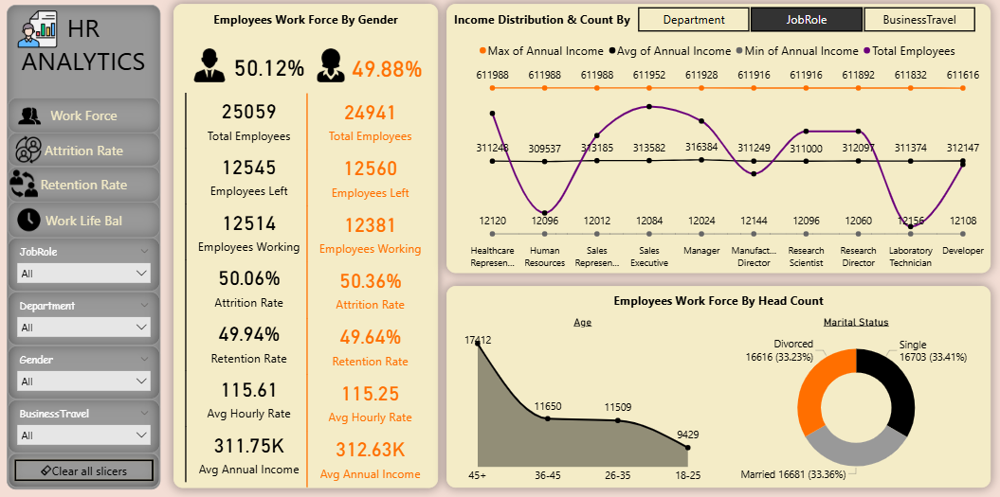
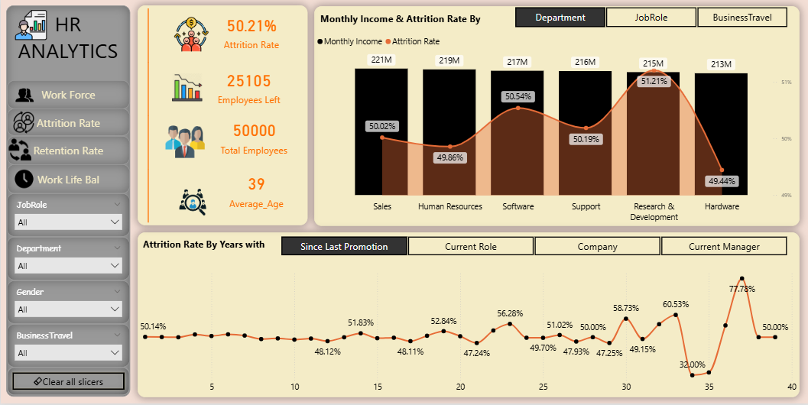
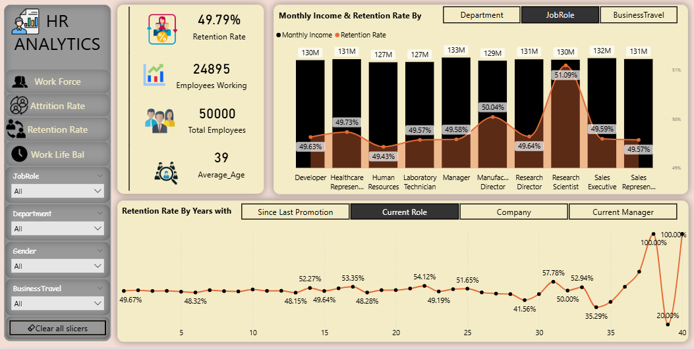
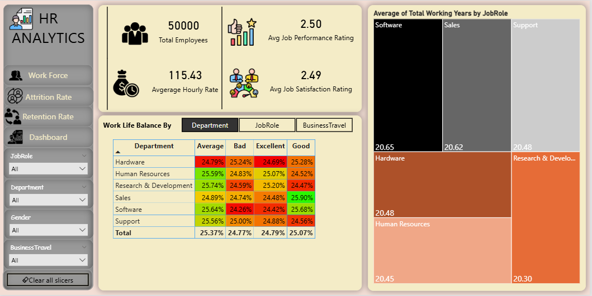

# 👥 HR Analytics Dashboard - Power BI

## 📌 Overview
This project presents an **HR Analytics Dashboard** built in **Power BI**, providing end-to-end insights into workforce composition, employee attrition, retention, income distribution, and work-life balance for **50,000 employees**. The dashboard is divided into four reports:

1. **Work Force Report**
2. **Attrition Rate Report**
3. **Retention Rate Report**
4. **Work-Life Balance Report**

---

## 👥 1. Work Force Report

The Work Force Report gives a complete view of the employee base, split by gender, with income distribution, age groups and marital status. It helps HR teams understand who works in the company and how pay and demographics are spread.

---

## 🖼️ Snapshot

*Snapshot of the Work Force Report created in Power BI.*

---

## ⚡ Key Features

* **Gender-wise KPI Panels** showing Total Employees, Employees Left, Employees Working, Attrition Rate, Retention Rate, Avg Hourly Rate and Avg Annual Income.
* **Income Distribution Chart** (Max, Avg, Min Annual Income and Total Employees) with toggle buttons for **Department, Job Role and Business Travel**.
* **Area Chart** → Employees by Age Group.
* **Donut Chart** → Employees by Marital Status.
* **Dynamic Filters (Slicers):** Job Role, Department, Gender, Business Travel, with a *Clear all slicers* button.

---

## 📊 KPIs & Metrics Used

| Metric | Male | Female |
|---|---|---|
| Total Employees | 25,059 (50.12%) | 24,941 (49.88%) |
| Employees Left | 12,545 | 12,560 |
| Employees Working | 12,514 | 12,381 |
| Attrition Rate | 50.06% | 50.36% |
| Retention Rate | 49.94% | 49.64% |
| Avg Hourly Rate | 115.61 | 115.25 |
| Avg Annual Income | 311.75K | 312.63K |

---

## 🔑 Key Insights

* The workforce is almost perfectly balanced: **50.12% male and 49.88% female**.
* Attrition is similar for both genders (**50.06% vs 50.36%**).
* Employees aged **45+ are the largest group (17,412)**; ages **18–25 are the smallest (9,429)**.
* Marital status is evenly split: **Single 33.41%, Married 33.36%, Divorced 33.23%**.
* Average annual income is nearly the same for both genders (about **312K**).

---

## 📉 2. Attrition Rate Report

The Attrition Rate Report shows how many employees have left and where attrition is highest, by department and by years of service milestones.

---

## 🖼️ Snapshot

*Snapshot of the Attrition Rate Report created in Power BI.*

---

## ⚡ Key Features

* **KPI Cards:** Attrition Rate, Employees Left, Total Employees, Average Age.
* **Combo Chart:** Monthly Income (columns) and Attrition Rate (line) with toggles for **Department, Job Role and Business Travel**.
* **Line Chart:** Attrition Rate by years **Since Last Promotion, in Current Role, at the Company and with the Current Manager**.
* **Slicers:** Job Role, Department, Gender, Business Travel.

---

## 📊 KPIs & Metrics Used

* **Attrition Rate:** 50.21%
* **Employees Left:** 25,105
* **Total Employees:** 50,000
* **Average Age:** 39

---

## 🔑 Key Insights

* **Research & Development has the highest attrition (51.21%)**, followed by Software (50.54%).
* **Hardware has the lowest attrition (49.44%)**, then Human Resources (49.86%).
* Attrition is close to 50% in every department, so it is a company-wide issue rather than a single-team problem.
* Attrition by years since last promotion is volatile at the long-tenure end, peaking at **77.78%**, but those points rest on very few employees.

---

## 🔒 3. Retention Rate Report

The Retention Rate Report shows how many employees stay and which roles and tenure groups retain best.

---

## 🖼️ Snapshot

*Snapshot of the Retention Rate Report created in Power BI.*

---

## ⚡ Key Features

* **KPI Cards:** Retention Rate, Employees Working, Total Employees, Average Age.
* **Combo Chart:** Monthly Income and Retention Rate by **Job Role / Department / Business Travel**.
* **Line Chart:** Retention Rate by years Since Last Promotion, in Current Role, at the Company and with the Current Manager.
* **Slicers:** Job Role, Department, Gender, Business Travel.

---

## 📊 KPIs & Metrics Used

* **Retention Rate:** 49.79%
* **Employees Working:** 24,895
* **Total Employees:** 50,000
* **Average Age:** 39

---

## 🔑 Key Insights

* **Research Scientists have the highest retention (51.09%)**, followed by Manufacturing Directors (50.04%).
* **Human Resources has the lowest role-level retention (49.43%)**.
* Monthly income is similar across roles (about 127M–133M in total), so pay level alone does not explain retention differences.
* Retention is below 50% overall, which leaves room for improvement in engagement and career growth programs.

---

## ⚖️ 4. Work-Life Balance Report

The Work-Life Balance Report combines overall workforce KPIs with work-life balance ratings by department and average working years.

---

## 🖼️ Snapshot

*Snapshot of the Work-Life Balance Report created in Power BI.*

---

## ⚡ Key Features

* **KPI Cards:** Total Employees, Average Hourly Rate, Avg Job Performance Rating, Avg Job Satisfaction Rating.
* **Matrix with Conditional Formatting:** Work-Life Balance (Bad, Average, Good, Excellent) by **Department / Job Role / Business Travel**.
* **Treemap:** Average Total Working Years.
* **Slicers:** Job Role, Department, Gender, Business Travel.

---

## 📊 KPIs & Metrics Used

* **Total Employees:** 50,000
* **Average Hourly Rate:** 115.43
* **Avg Job Performance Rating:** 2.50
* **Avg Job Satisfaction Rating:** 2.49

---

## 🔑 Key Insights

* Work-life balance ratings are spread almost evenly: **Average 25.37%, Good 25.07%, Excellent 24.79%, Bad 24.77%**.
* **Sales has the highest share of "Good" ratings (25.90%)**, and Human Resources has the lowest "Bad" share after Research & Development.
* Average working years are similar across departments (**about 20.3 to 20.7 years**), with Software highest at 20.65.
* Performance (2.50) and job satisfaction (2.49) ratings are both mid-range.

---

## 🛠️ Tools & Technology Used

* **Power BI** → Data Modeling, DAX, Interactive Visualizations
* **DAX Measures:** Total Employees, Employees Left, Attrition Rate %, Retention Rate %, Avg Hourly Rate, Avg Annual Income
* **Bookmarks / Toggle Buttons** → Switch between Department, Job Role and Business Travel views
* **Navigation Buttons** → Move across Work Force, Attrition Rate, Retention Rate and Dashboard pages
* **Slicers** → Interactive filtering

---

## 🗂️ Data Fields Used

* **Employee Information:** Gender, Age, Marital Status, Job Role, Department, Business Travel.
* **Income Fields:** Hourly Rate, Monthly Income, Annual Income.
* **Attrition Fields:** Attrition (Yes/No), Employees Left, Employees Working.
* **Tenure Fields:** Total Working Years, Years Since Last Promotion, Years in Current Role, Years at Company, Years with Current Manager.
* **Rating Fields:** Job Performance Rating, Job Satisfaction Rating, Work-Life Balance.

---

## 🎛️ Interactivity & Design

* **Filters (Slicers):** Job Role, Department, Gender, Business Travel on every page, plus a *Clear all slicers* button.
* **Toggle Buttons:** Switch charts between Department, Job Role and Business Travel, and between tenure measures.
* **Navigation Buttons:** Work Force ↔ Attrition Rate ↔ Retention Rate ↔ Work-Life Balance.
* **Design Choices:**
  * Consistent **cream, orange and black color theme** across all pages.
  * **KPI cards with icons** for quick reading.
  * Left-side navigation panel and slicers, charts on the right.

---

## 🏷️ Tags

`#PowerBI` `#HR Analytics` `#Attrition Analysis` `#Employee Retention` `#Dashboard` `#Data Visualization` `#KPIs` `#DAX`

---

## 🎯 Click Below to Explore the Dashboard

  
  <a href="YOUR_POWER_BI_PUBLISH_LINK" target="_blank">
    🚀 Launch Live Dashboard
  </a>

---

##  Author

**Syed Yaseen**  
*Aspiring Data Analyst | Power BI | Excel | SQL | Tableau*

⭐ **Don't forget to star the repo if you found it helpful!**
